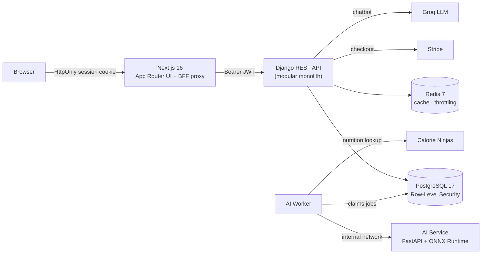
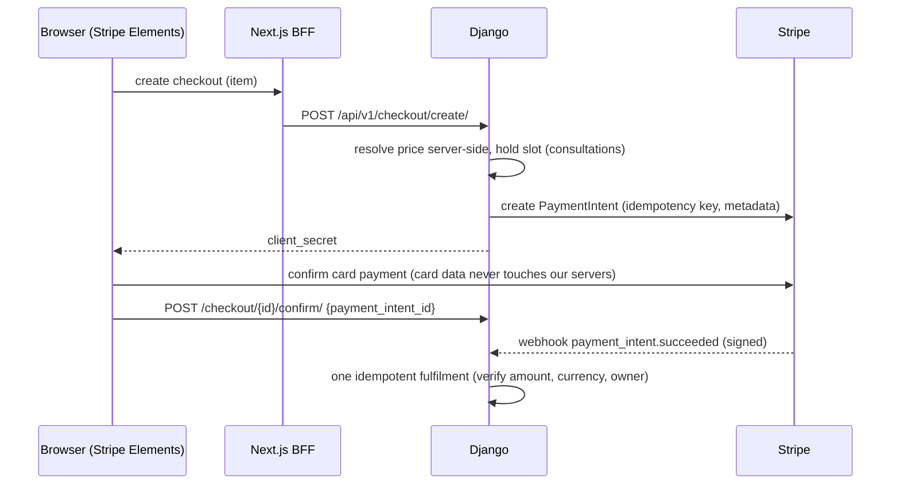
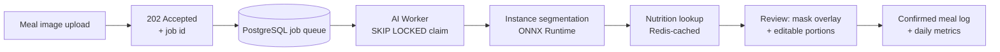

# Personalized Dietary Assessment Platform


**NutriPlatform** (also known as **DietOn** / **SVMB**) is a web-based platform for **personalized nutrition consultation** and **AI-assisted calorie estimation**, developed as an academic project for L3 Computer Science.

The system combines:

- Professional nutritionist consultations
- Structured diet plans, a meal plan marketplace and subscriptions
- AI-based food recognition with instance segmentation for approximate calorie estimation
- Multiple dashboard systems for: Clients, Nutritionists, Admin
- Nutrition chatbot & platform helper
- A cinematic, WebGL-powered landing experience and a three-theme design system

> **Note:** NutriPlatform provides automated dietary insights and approximate calorie estimations. It is not a diagnostic tool and does not replace advice from a qualified healthcare professional.

---
##  Preview Video Link
https://vimeo.com/1222755957?fl=ip&fe=ec

## Table of Contents

- [Project Overview](#project-overview)
- [Roles & Access](#roles--access)
- [Architecture Overview](#architecture-overview)
- [Tech Stack](#tech-stack)
- [Repository Structure](#repository-structure)
- [Security & Privacy Considerations](#security--privacy-considerations)
- [Payments, Subscriptions & Invoicing](#payments-subscriptions--invoicing)
- [AI & Data Processing Pipeline](#ai--data-processing-pipeline)
- [Frontend Experience & Creative Tech](#frontend-experience--creative-tech)
- [Platform Usability & Experience](#platform-usability--experience)
- [Monitoring, Reliability & Maintainability](#monitoring-reliability--maintainability)
- [Getting Started](#-getting-started)
- [Configuration Reference](#configuration-reference)
- [Testing & Quality](#testing--quality)
- [Troubleshooting](#troubleshooting)
- [Known Limitations & Project Status](#known-limitations--project-status)
- [Extensibility & Future Evolution](#-extensibility--future-evolution)
- [Team & Workflow](#team--workflow)
- [Documentation](#documentation)
- [License](#-license)

##  Project Overview

Users can:

- Create a personal profile with profile information, health history & calorie and nutrient goals
- View and edit profile information
- View overview statistics and charts on their nutrition
- Browse the meal plan marketplace, purchase plans, and follow personalized nutrition plans designed by professionals day by day
- View notifications
- Upload meal images for AI-assisted calorie estimation, with ingredient mask overlays and adjustable portion sizes before confirming
- Log meals manually and manage and track meal history
- Book and attend online nutrition consultations
- Chat with the built-in nutrition assistant
- Share posts and engage with the community through comments and replies (subject to admin approval/rejection)
- Manage personal subscription (free / premium)
- Check invoices and download receipts as PDF
- Contact Administrators through the support ticket system
- Track progress over time
- Post reviews and star ratings for meal plans and consultations (nutritionists)

Nutritionists can:

- Create a personal profile through strict registration with certification upload, subject to administrator approval/rejection
- View and edit profile information
- View notifications
- View overview dashboard statistics and earnings chart
- View and manage weekly schedule through a visual weekly time grid with real time configuration and holiday management
- View patient list with patient calorie target progress charts and meal plan progression, with a personalized meal plan creation interface
- Keep private clinical notes for each patient
- Manage and conduct online consultations through shared meeting links
- Construct and view/edit public marketplace meal plans (general & seasonal)
- View earnings through commission, invoices, and payout history
- Contact Administrators through the support ticket system

Administrators can:

- View overview website statistics and recent activity (sign ups, pending approvals, plans, revenue...etc)
- View notifications
- Manage users (Nutritionists and Clients): view, ban, unban and delete permanently (soft delete on db)
- Manage nutritionist application approvals
- Manage pending plan approvals, manage live marketplace
- Manage platform subscription content and price
- Manage community content (approve posts, reject, hide, delete)
- Manage blog editorial content
- Respond to inquiries and tickets (support)

---

## Roles & Access

| Capability | Client | Nutritionist | Admin |
| :--- | :---: | :---: | :---: |
| Own profile and health data | ✅ | ✅ (own) | ✅ |
| Patient data | ❌ | assigned patients only | ✅ |
| AI calorie estimation | Premium | ❌ | ❌ |
| Create marketplace plans | ❌ | ✅ (after approval) | approves |
| Certifications | ❌ | own upload | review |
| Moderation, pricing, users | ❌ | ❌ | ✅ |

---

## Architecture Overview

This project follows an **API-first modular monolith architecture** with a Backend-for-Frontend proxy layer, an asynchronous AI job pipeline and a dedicated, isolated AI service.



- **Frontend** (Next.js) handles UI, user interactions, and acts as a same-origin BFF proxy: the browser never touches raw tokens
- **Backend API** (Django REST Framework) handles authentication, business logic, and data storage, organized into domain apps: `users`, `client`, `nutritionist`, `marketplace`, `admin_panel`, `community`, `chatbot`, `notifications`
- **AI Worker** picks up queued meal-analysis jobs from PostgreSQL and orchestrates the inference and nutrition lookup
- **AI Service** performs food segmentation and portion estimation on a private internal network

---

## Tech Stack

**Frontend**
- Next.js 16 (App Router, Turbopack) with a Node.js BFF proxy
- React 19 / TypeScript
- Tailwind CSS v4, shadcn/ui & Radix UI primitives
- GSAP (ScrollTrigger), Lenis smooth scrolling, Framer Motion
- OGL (WebGL2) with custom GLSL shaders
- Recharts, Zod, Stripe Elements

**Backend**
- Django 5.2 & Django REST Framework
- JWT Authentication (SimpleJWT) with Argon2id password hashing
- PostgreSQL 17 with Row-Level Security
- Redis 7 (caching, rate limiting, account lockout)
- Stripe (payments), Groq (nutrition chatbot), Calorie Ninjas (nutrition data)
- OpenAPI documentation via drf-spectacular (`/api/docs/`)

**AI Service**
- Python
- FastAPI
- YOLOv8l-seg (pretrained + adjusted), exported to ONNX and served through ONNX Runtime
- OpenCV & Pillow for image processing

**DevOps**
- GitHub (monorepo) with GitHub Actions CI
- Docker & Docker Compose (full multi-service stack)
- Gitleaks, Bandit, pip-audit, npm audit, Dependabot

---

## Repository Structure

```
/
├── frontend/          # Next.js application & BFF proxy
├── backend/           # Django REST API (backend/nutriplatform)
├── ai-service/        # AI inference service (ai-service/food_api)
├── docs/              # Architecture, API & performance documentation
├── scripts/           # Monorepo launcher & preflight checks
├── .github/           # CI workflows & templates
├── docker-compose.yml
└── README.md
```

---

## Security & Privacy Considerations

**Identity & sessions**
- Role-based access control across Clients, Nutritionists, and Administrators
- JWT authentication delivered through `HttpOnly; Secure; SameSite=Lax` cookies, with transparent server-side token refresh in the BFF proxy
- CSRF defense through origin validation and custom-header enforcement on every mutating request
- Argon2id password hashing, composite IP + email rate limiting, progressive account lockout and Cloudflare Turnstile bot protection on login and registration

**Data protection**
- PostgreSQL Row-Level Security on tenant tables, so users and nutritionists only ever reach their own records
- Sensitive health data (health history, clinical notes, progress notes, meeting links) encrypted at the field level with versioned, rotation-ready Fernet keys
- Separation of sensitive health data from public community content
- Nutritionist access limited strictly to their own patients
- Soft-delete mechanisms to preserve data integrity and auditability

**Content & uploads**
- Tiered, authoritative media serving: certifications are staff-only, client avatars are limited to the owner, their nutritionist and staff, and AI image logs are never publicly reachable
- Centralized upload hardening: size limits, magic-byte validation, EXIF stripping, safe re-encoding and randomized storage names
- Dedicated validation serializers on every endpoint
- Administrative moderation layers for community posts, plans, and professional profiles

**Platform & delivery**
- Strict Content-Security-Policy, HSTS, frame and content-type protections on every response
- Fail-fast startup checks that refuse to boot with missing or weak secrets
- Secrets scanning, static analysis and dependency auditing on every push

---

## Payments, Subscriptions & Invoicing

- Tiered access model (Free vs Premium)
- Premium features gated at the backend and UI level
- Stripe-powered checkout for meal plans, consultations and subscriptions
- Server-authoritative pricing: amounts are always resolved on the backend and verified against the payment before anything is unlocked
- Signed, idempotent Stripe webhook handling
- Consultation slots held securely during checkout
- Centralized invoice history with unique invoice generation and PDF receipts
- Commission-based revenue model for nutritionists
- Administrative control over subscription pricing and platform offerings

### Checkout flow



### Payments in development

1. Create a Stripe account, stay in **test mode**, and copy the `sk_test_` and `pk_test_` keys.
2. Run the webhook forwarder: `stripe listen --forward-to localhost:8000/api/v1/checkout/webhook/`.
3. Put the `whsec_` it prints in `backend/nutriplatform/.env`.
4. Test cards: `4242 4242 4242 4242` (success), `4000 0025 0000 3155` (3D Secure), `4000 0000 0000 9995` (decline).
5. No Stripe account? Set `PAYMENTS_MODE=fake` (refused when `DEBUG=False`).

---

## AI & Data Processing Pipeline



- Image-based food recognition using instance segmentation models
- Portion estimation from segmentation masks, with a user-adjustable correction layer
- Automatic macro and calorie calculation, with nutrition lookups decoupled from inference and cached in Redis
- Asynchronous, non-blocking submission: uploads return immediately and the client follows progress through a polling flow
- Resilient job queue with atomic claiming, lease heartbeats, automatic retries and timeout handling
- Admission control on the AI service keeps inference stable under load by shedding excess requests gracefully
- CPU-tuned ONNX Runtime sessions (explicit thread allocation, graph optimization) and bounded image decoding
- Client-side image compression before upload
- Incremental updates to daily nutrition metrics
- Decoupled AI service on an internal-only network, authenticated with a shared secret, allowing independent scaling and iteration
- Designed to support future model upgrades or alternative inference engines

Benchmark notes live in [`docs/perf/ai-after.md`](docs/perf/ai-after.md).

> Under 20 concurrent uploads, the original synchronous pipeline blocked all four server threads for about 63 s, and most health probes timed out (limited baseline). The asynchronous pipeline acknowledged every upload in about 2 s and completed 15 of 15 queued jobs in 75 s with a warm nutrition cache, with zero probe errors. Submit and probe latency targets were not met on the single-machine test rig.

---

## Frontend Experience & Creative Tech

- **WebGL2 / GLSL shader transition**: the landing hero dissolves into the services stage through a custom OGL fragment shader (fractional Brownian motion noise, chromatic aberration and directional smear) driven by scroll progress
- **Scroll-driven storytelling**: GSAP ScrollTrigger and Lenis orchestrate a pinned, layered landing page with a custom scroll progress indicator
- **Graceful degradation**: the shader falls back to a smooth CSS bridge when WebGL2 is unavailable, and the experience respects `prefers-reduced-motion`
- **Three themes**: Light, Dark and Special, built on Tailwind v4 design tokens (the landing page is showcased in Special)
- **Role dashboards**: redesigned Client, Nutritionist and Admin dashboards that share one design language
- **Overlay sidebar rail**: an icon rail that expands on hover or focus, with grouped, role-specific navigation and a pin option
- **Data visualization**: Recharts-powered progress, macro and earnings charts

---

## Platform Usability & Experience

- Role-specific dashboards with tailored navigation and data visibility
- Progressive onboarding for users with health and goal profiling
- Visual progress indicators and charts for long-term tracking
- Floating nutrition assistant powered by a Groq-hosted LLaMA 3.3 70B model
- Community features designed with moderation-first workflows
- Marketplace-style browsing for meal plans and consultations
- Notification system for cross-role communication and updates

---

## Monitoring, Reliability & Maintainability

- Clear separation of concerns between frontend, backend, worker and AI services
- API contracts documented through OpenAPI and version-aware (`/api/v1/`)
- Database schema designed around traceability (users, plans, consultations, invoices)
- Structured logging and error handling at the API layer
- Health checks and one-command orchestration through Docker Compose
- Automated test suites across every layer and a 5-gate CI pipeline on every push and pull request
- Architecture designed to support future horizontal scaling

---

## 🚀 Getting Started

### AI model file

The YOLOv8 segmentation model (`best_foodinsseg.onnx`, ~176 MB) is **not stored in git**.
Place it at `ai-service/food_api/best_foodinsseg.onnx` before starting the AI service.
In Docker Compose it is bind-mounted from the host. The AI service refuses to start
if the file is missing. CI sets `AI_ALLOW_MISSING_MODEL=true` to run its model-free tests.
Never set that flag in production.

### Option A: Monorepo launcher (local development)

Prerequisites: Node.js 20+, Python 3.11, PostgreSQL 17 and Redis 7 (or Docker for Redis).

```bash
# Install dependencies
npm install
cd frontend && npm install && cd ..
cd backend/nutriplatform && python -m venv venv && source venv/bin/activate && pip install -r requirements.txt && cd ../..
cd ai-service/food_api && pip install -r requirements.txt && cd ../..

# Configure environment
cp backend/nutriplatform/.env.example backend/nutriplatform/.env
cp ai-service/food_api/.env.example ai-service/food_api/.env
cp frontend/.env.example frontend/.env.local

# Launch everything
npm run dev
```

`npm run dev` runs a preflight check (PostgreSQL, Redis, migrations, demo data) and then starts every service together:

| Service | URL |
| :--- | :--- |
| Frontend | http://localhost:3000 |
| Backend API (docs at `/api/docs/`) | http://127.0.0.1:8000 |
| AI Service | http://127.0.0.1:8001 |
| AI Worker | background daemon |

Demo accounts are seeded automatically (password: `DemoPassword123!`):
`demo_client@nutriplatform.local`, `demo_nutritionist@nutriplatform.local`, `demo_admin@nutriplatform.local`

### Option B: Docker Compose

```bash
cp .env.docker.example .env
docker compose up --build
```

This brings up PostgreSQL, Redis, migrations, the Django backend, the AI worker, the isolated AI service and the Next.js frontend.

---

## Configuration Reference

| Variable | Service | Purpose |
| :--- | :--- | :--- |
| `SECRET_KEY` | backend | Django signing key |
| `DB_*` | backend | PostgreSQL connection |
| `FIELD_ENCRYPTION_KEYS` | backend | Fernet key list for encrypted health fields |
| `STRIPE_SECRET_KEY`, `STRIPE_WEBHOOK_SECRET` | backend | Payments |
| `PAYMENTS_MODE` | backend | `stripe` (default) or `fake` (DEBUG only) |
| `GROQ_API_KEY` | backend | Chatbot |
| `AI_SERVICE_URL`, `AI_SERVICE_SECRET_KEY` | backend, worker, AI service | Internal AI service authentication |
| `AI_ASYNC_PIPELINE` | backend | `True` for the async queue, `False` for the synchronous fallback |
| `AI_ONNX_INTRA_THREADS` | AI service | ONNX threads (match the container CPU limit) |
| `NEXT_PUBLIC_STRIPE_PUBLISHABLE_KEY` | frontend | Baked in at build time (Docker build arg) |

Templates: `backend/nutriplatform/.env.example`, `ai-service/food_api/.env.example`,
`frontend/.env.example`, `.env.docker.example`. Never commit real `.env` files.

---

## Testing & Quality

```bash
# Frontend: unit/integration (Vitest) and end-to-end (Playwright)
cd frontend && npm run test && npm run test:e2e

# Backend: Django test suites (security, payments, uploads, media, worker queue)
cd backend/nutriplatform && python manage.py test

# AI service
cd ai-service/food_api && python test_ai_service.py
```

GitHub Actions runs five parallel gates on every push: secret scanning (Gitleaks), Python SAST and dependency audit (Bandit + pip-audit), frontend checks (npm audit, ESLint, Vitest, build), backend tests, and AI service tests.

---

## Troubleshooting

- **AI service exits at startup**: the model file is missing (see *AI model file*).
- **Upload stays "queued"**: the AI worker isn't running. Start it with `python manage.py run_ai_worker`.
- **Rate limiting and caching errors**: check that Redis is running on `127.0.0.1:6379`.
- **Payments return 503**: Stripe keys aren't set. Add test keys or use `PAYMENTS_MODE=fake` in DEBUG.
- **Avatars don't load**: media is served through the authenticated proxy at `/api/backend/media/...`, so you need to be logged in.

---

## Known Limitations & Project Status

- **Calorie estimates are approximate.** Portion mass comes from segmentation fill ratio, not a depth or weight sensor.
- **CPU-only inference.** One image takes about 2.5 to 3 s. The AI service runs a single inference slot, and a single worker processes the queue. The global queue cap is sized so jobs drain inside the 180 s job deadline.
- **Benchmarks were run on one Windows machine**, with the load generator, database, worker and server all sharing 4 cores. Latency targets for submit and health probes were not met on that rig. See [`docs/perf/ai-after.md`](docs/perf/ai-after.md) for the exact setup and caveats.
- **Meeting links are plain URLs.** There is no Zoom or Meet API integration yet.
- **Third-party dependencies**: the chatbot needs a Groq key, and nutrition lookups need a Calorie Ninjas key (cached in Redis once fetched).

---

## 🚀 Extensibility & Future Evolution

The platform is designed to support future enhancements such as:

- Advanced analytics and personalized insights
- Additional AI-assisted dietary features
- Internationalization and localization
- Expanded professional roles
- Automated video-meeting provisioning for consultations
- Server-side PDF generation for invoices and reports
- Integration with wearable or external health data sources
- Extended payment options and automated nutritionist payouts
- Enhanced recommendation systems

---

## Team & Workflow

This project is developed using:

- Feature-based Git branches
- Pull Requests with mandatory review
- Documented API contracts
- Automated security and quality gates in CI

See [`docs/git-workflow.md`](docs/git-workflow.md) for details.

---

## Documentation

| Document | Contents |
| :--- | :--- |
| [`docs/api/food-analysis.md`](docs/api/food-analysis.md) | AI job API contract and error codes |
| [`docs/perf/ai-before.md`](docs/perf/ai-before.md), [`ai-after.md`](docs/perf/ai-after.md) | Benchmarks and their limits |
| [`docs/workstream-handoff.md`](docs/workstream-handoff.md) | RLS contract, media tiers, deployment order |
| [`docs/compose-smoke-test.md`](docs/compose-smoke-test.md) | Docker verification checklist |
| [`docs/git-workflow.md`](docs/git-workflow.md) | Branching and review process |

---

## 📜 License

GNU Affero General Public License v3.0
