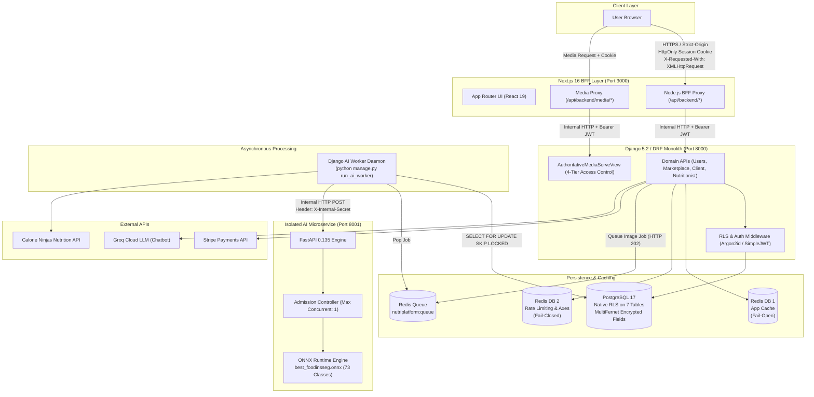
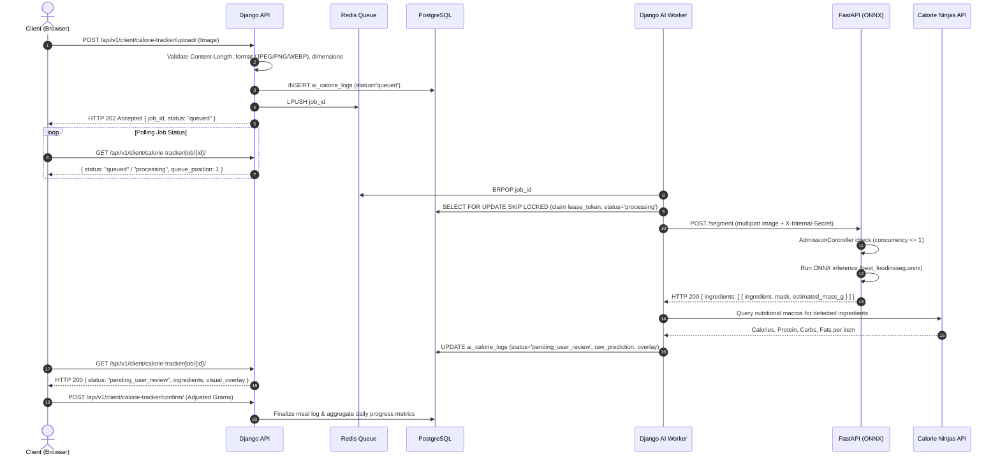
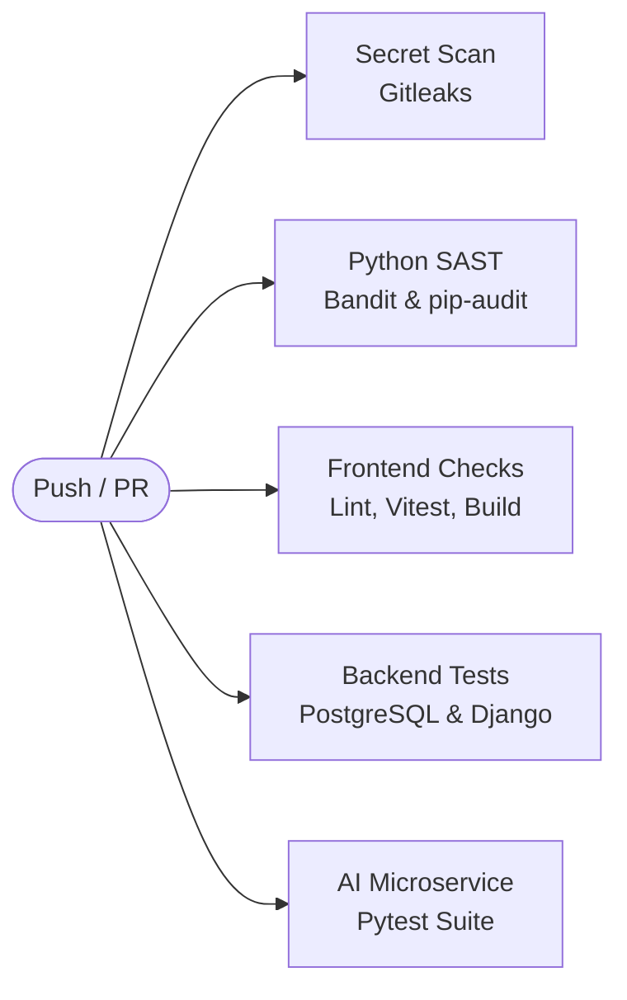

# NutriPlatform (DietOn / SVMB) 🥗🍎

[](https://github.com/AkramBFS/personalized-dietary-platform/actions/workflows/ci.yml)
[](LICENSE)
[](https://nextjs.org/)
[](https://www.djangoproject.com/)
[](https://fastapi.tiangolo.com/)
[](https://www.postgresql.org/)
[](https://redis.io/)

A full-stack, AI-assisted personalized dietary consultation and nutritional assessment platform developed as an L3 Computer Science thesis project. The system pairs computer vision ingredient segmentation and automated calorie estimation with professional nutritionist consultations, meal plan marketplaces, and multi-role operational dashboards.

> [!WARNING]
> **Medical Disclaimer**: NutriPlatform provides automated dietary insights, volumetric mass approximations, and lifestyle tracking. It is **not a diagnostic tool and does not provide medical advice**. Consult a qualified physician or healthcare provider for clinical medical conditions.

---

## 📋 Table of Contents
- [Architecture & Service Topology](#-architecture--service-topology)
- [Technology Stack](#-technology-stack)
- [System Features by Role](#-system-features-by-role)
- [Asynchronous AI Vision Pipeline](#-asynchronous-ai-vision-pipeline)
- [Security Architecture & Data Protection](#-security-architecture--data-protection)
- [Frontend Experience & Creative Tech](#-frontend-experience--creative-tech)
- [Quickstart & Local Setup](#-quickstart--local-setup)
- [Environment Variables](#-environment-variables)
- [Verification, Testing & CI/CD](#-verification-testing--cicd)
- [Known Limitations & Roadmap](#-known-limitations--roadmap)
- [License & Academic Context](#-license--academic-context)

---

## 🏗 Architecture & Service Topology

NutriPlatform operates as an **API-first modular monolith** backed by an isolated computer-vision microservice, an asynchronous Redis task queue worker, and an edge Next.js Backend-For-Frontend (BFF) proxy.



### Request Lifecycle & Boundaries
1. **Edge Client ↔ Node.js BFF**: The browser communicates solely with the Next.js App Router Node.js proxy (`/api/backend/[...path]`). The proxy validates request origins, requires custom headers (`x-requested-with: XMLHttpRequest`) on mutative calls to eliminate scriptless CSRF, manages `HttpOnly; Secure; SameSite=Lax` session cookies, and handles transparent JWT refresh without exposing access tokens to JavaScript.
2. **Backend Core**: Built in Django 5.2 and Django REST Framework. Orchestrates authentication, multi-tenant database policies, payments, and asynchronous AI tasks.
3. **Internal AI Network**: The FastAPI service runs inside an internal Docker network (`internal_ai_net: internal=true`) with no public gateway exposure. Inter-service calls require a shared secret passed via `X-Internal-Secret` and validated using constant-time HMAC comparison.

---

## 🧰 Technology Stack

### Frontend Application
| Category | Technology | Pinned Version | Notes |
| :--- | :--- | :--- | :--- |
| **Framework** | Next.js | `16.1.6` | App Router, Turbopack, Node.js BFF proxy runtime (`runtime = 'nodejs'`) |
| **Core UI** | React / React DOM | `19.2.3` | React 19 server and client component paradigms |
| **Styling** | Tailwind CSS | `^4.0.0` | `@tailwindcss/postcss`, `tw-animate-css`, `shadcn` primitives |
| **WebGL & Shaders** | OGL | `1.0.11` | Minimal WebGL2 library executing custom GLSL transitions |
| **Animation & Motion** | GSAP & Lenis | `3.14.2` / `1.3.23` | ScrollTrigger pinning, card stacking, smooth scrolling |
| **Component Primitives** | Radix UI / Headless UI | `^1.4.3` / `^2.2.9` | Accessible dialogs, dropdowns, command palettes, tabs |
| **Charts & Tables** | Recharts / TanStack Table | `^2.15.4` / `^8.21.3` | Daily calorie charts, dynamic data grids |
| **Forms & Validation** | React Hook Form / Zod | `^7.71.1` / `^4.3.6` | Client-side schema verification and type generation |

### Backend Monolith
| Category | Technology | Pinned Version | Notes |
| :--- | :--- | :--- | :--- |
| **Framework** | Django / DRF | `>=5.2.17` / `>=3.17.2` | Modular monolith architecture with 10 internal applications |
| **Auth & Security** | SimpleJWT / Argon2id | `>=5.5.1` / `>=25.1.0` | Sliding refresh tokens, token blacklisting, Argon2id password hashing |
| **Brute-Force & Abuse** | django-axes / django-ratelimit | `>=8.3.1` / `>=4.1.0` | 5-failure lockout (30 min cooldown), composite IP+Email throttling |
| **Field Encryption** | Cryptography (MultiFernet) | `>=46.0.3` | Envelope symmetric encryption (`v1:<token>`) for sensitive clinical fields |
| **API Documentation** | drf-spectacular | `>=0.29.0` | OpenAPI 3.0 schema generation |
| **External Integrations** | Stripe / Groq | `>=15.6.1` / `>=1.2.0` | Stripe payment verification and Groq LLaMA/Mixtral LLM assistant |

### AI Vision Microservice & Storage
| Category | Technology | Pinned Version | Notes |
| :--- | :--- | :--- | :--- |
| **Microservice** | FastAPI / Uvicorn | `>=0.135.3` / `>=0.44.0` | Asynchronous inference endpoints (`/segment`, `/segment/image`) |
| **Inference Engine** | ONNX Runtime | `>=1.24.4` | CPU-pinned ONNX runtime with graph optimization (`ORT_ENABLE_ALL`) |
| **Segmentation Model** | `best_foodinsseg.onnx` | Custom Export | YOLOv8l-seg architecture trained on FoodInsSeg (73 food categories) |
| **Image Processing** | OpenCV / Pillow | `>=4.11.0` / `>=12.3.0` | Bounded decoding, decompression bomb prevention, EXIF stripping |
| **Database** | PostgreSQL | `17-alpine` | Native Row-Level Security on 7 tables, non-superuser role isolation |
| **In-Memory Cache** | Redis | `7-alpine` | Dual-cache configuration (App cache on DB 1, Rate limits on DB 2) |

---

## 👥 System Features by Role

The platform provides dedicated interfaces, navigation schemes, and permission scopes for Clients, Nutritionists, and Administrators:

| Role | Domain / Feature | Implementation State | Technical Verification & Behavior |
| :--- | :--- | :---: | :--- |
| **Client** | Profile & Health History | **Complete** | Tracks height, weight, BMI, allergens, and dietary goals. Clinical notes encrypted with `MultiFernet`. |
| **Client** | AI Food Recognition & Logging | **Complete** | Async image ingestion, queue polling, ingredient mask visualization, portion mass adjustment, and macro aggregation. |
| **Client** | Manual Meal Tracking | **Complete** | Manual food entry by category (Breakfast, Lunch, Dinner, Snack) with daily macro targets. |
| **Client** | Meal Plans & Progression | **Complete** | Public catalog displays Day 1 preview; full plan unlocked after purchase. Day-by-day recipe checklist progression. |
| **Client** | Consultation Booking | **Partial** | Direct booking endpoint returns HTTP 410 GONE. Sessions are booked via marketplace checkout sessions. Meeting links are stored as URL strings. |
| **Client** | Invoicing & Receipts | **Complete** | Transaction history and client-side printable PDF receipt generation via `window.print()` in `pdfReceipt.ts`. |
| **Client** | AI Nutrition Chatbot | **Complete** | Floating assistant backed by Groq API with conversational session context and diet guardrails. |
| **Client** | Support Ticket Submissions | **Stubbed** | Interface provides ticket forms; API errors are caught and surfaced via local demonstration toasts. |
| **Nutritionist** | Registration & Onboarding | **Complete** | Multi-step registration, specialty assignment, and certification upload with MIME-type verification. |
| **Nutritionist** | Schedule & Availability | **Complete** | Visual weekly schedule grid, custom time-slot intervals, and holiday exception toggles. |
| **Nutritionist** | Patient Roster & Charts | **Complete** | Patient directory, target adherence charts, custom meal plan assignment, and encrypted private clinical notes. |
| **Nutritionist** | Marketplace Authoring | **Complete** | Authoring interface for public meal plans with macro breakdowns, pricing, and submission for admin approval. |
| **Nutritionist** | Earnings & Payout Logs | **Complete** | Breakdown of consultation and meal plan commissions with payout tracking. |
| **Nutritionist** | Support Ticket Submission | **Broken** | Form targets `/client/feedback/`, which returns HTTP 403 Forbidden because permissions enforce `IsClient`. |
| **Admin** | Analytical Overview | **Complete** | System metrics tracking user registrations, pending plan submissions, revenue, and active subscriptions. |
| **Admin** | User Directory & Moderation | **Complete** | Search, filter, role reassignment, account suspension (ban/unban), and soft deletion. |
| **Admin** | Practitioner Approvals | **Complete** | Verification queue for reviewing nutritionist profiles and inspecting uploaded credential documents. |
| **Admin** | Plan Moderation | **Complete** | Review queue for author-submitted marketplace meal plans prior to catalog publication. |
| **Admin** | Subscription Management | **Complete** | Server-authoritative tier pricing, billing intervals, and feature allocation. |
| **Admin** | Community Moderation | **Complete** | Post moderation tools to approve, reject, hide, or delete community forum posts and comments. |

---

## 🤖 Asynchronous AI Vision Pipeline

Food recognition and calorie estimation run on an asynchronous, queue-decoupled pipeline designed to prevent long-running inference tasks from blocking backend web threads.



### Pipeline Safeguards
* **Model Specs**: Single-model architecture running `best_foodinsseg.onnx` (YOLOv8l-seg, 73 classes trained on FoodInsSeg). Direct PyTorch is omitted from deployment to reduce footprint.
* **Admission Controller**: Located in `ai-service/food_api/app.py`. Enforces `MAX_CONCURRENT_INFERENCES=1` and `MAX_WAITING=1`. Overloaded calls receive HTTP 503 with a `Retry-After: 3` header.
* **CPU Pinning**: Inference sessions configure explicit thread allocations (`intra_op_num_threads=3`, `inter_op_num_threads=1`) matching container limits, disabling thread spinning (`allow_spinning=0`).
* **Image Bounds**: Rejects payloads exceeding 10 MB or images exceeding 40 Megapixels (`MAX_PIXELS = 40_000_000`) to prevent memory exhaustion and decompression bombs. Downscales intermediate frames to 1280px before letterboxing to 640x640.
* **Mass Estimation**: Portion mass is derived from segmentation mask pixel counts normalized against reference plate dimensions and bounded by USDA reference portions.

---

## 🔐 Security Architecture & Data Protection

The repository incorporates comprehensive defense-in-depth security mechanisms cross-checked against the 19 audit remediation milestones:

```mermaid
sequenceDiagram
    autonumber
    actor User as Browser
    participant BFF as Next.js 16 Node.js BFF Proxy
    participant Django as Django Monolith
    participant DB as PostgreSQL 17

    User->>BFF: POST /api/auth/login (email, password, turnstile_token)
    BFF->>Django: POST /api/v1/auth/login/
    Django->>Django: Verify Turnstile, check Axes lockout & rate limits
    Django->>Django: Verify Argon2id password hash
    Django-->>BFF: Return { access, refresh, user }
    BFF-->>User: Set-Cookie: access_token (HttpOnly; Secure; SameSite=Lax)<br/>Set-Cookie: refresh_token (HttpOnly; Secure; SameSite=Lax)

    Note over User,BFF: Subsequent Authenticated Requests
    User->>BFF: GET /api/backend/client/dashboard/ (Cookie sent automatically)
    BFF->>BFF: Verify CSRF (Origin/Referer check + X-Requested-With header)
    BFF->>Django: GET /api/v1/client/dashboard/ (Header: Bearer <access_token>)
    Django->>DB: SET LOCAL app.current_user_id = '<id>'<br/>SET LOCAL app.is_staff = 'false'
    DB->>DB: Evaluate Row-Level Security (RLS) policies
    DB-->>Django: Return tenant-isolated rows
    Django-->>BFF: HTTP 200 OK
    BFF-->>User: HTTP 200 OK
```

### Core Security Implementations
1. **Next.js BFF Proxy & Anti-CSRF**:
   * Browsers cannot access JWT tokens via client-side JavaScript. Session tokens reside in `HttpOnly; Secure; SameSite=Lax` cookies.
   * State-changing requests enforce same-origin verification and require an `X-Requested-With: XMLHttpRequest` custom header.
   * When an access token expires, the proxy catches the upstream 401 response, exchanges the refresh token, updates cookies, and transparently replays the request.
2. **PostgreSQL Row-Level Security (RLS)**:
   * Enabled via migrations on 7 tables: `clients`, `user_plans`, `invoices`, `consultations`, `patient_notes`, `ai_calorie_logs`, and `daily_progress_metrics`.
   * Enforced in application code by injecting session variables (`app.current_user_id`, `app.is_staff`) inside transactions via `RLSMiddleware` and `RLSJWTAuthentication`.
   * *Operational Note*: To enforce native PostgreSQL RLS, production connections should use the provisioned unprivileged application role `nutriplatform_app` rather than a database superuser (`BYPASSRLS`).
3. **Clinical Field Encryption**:
   * Sensitive medical fields (`Client.health_history`, `PatientNote.note_content`, `DailyProgressMetric.notes`, `Consultation.zoom_link`) use `EncryptedTextField`.
   * Backed by `cryptography.fernet.MultiFernet` with versioned `v1:<token>` storage envelopes, supporting graceful key rotation without mutating data on read.
4. **Authoritative Media Serving (4-Tier Classification)**:
   * All media requests pass through `AuthoritativeMediaServeView` (`/media/<path:file_path>`); static serving of media folders is disabled.
   * **Tier 1 (`certifications/*`)**: Staff-only access, served with `Content-Disposition: attachment; filename="certification.<ext>"`.
   * **Tier 2 (`profiles/clients/*`)**: Accessible only by the client owner, assigned nutritionist, or staff.
   * **Tier 3 (`profiles/nutritionists/*`, `plans/covers/*`, `posts/*`)**: Accessible by authenticated users (or default public placeholders).
   * **Tier 4 (`ai_logs/*`)**: Hard blocked; returns HTTP 404 unconditionally for external callers.
5. **Universal Validation & Upload Sanitization**:
   * Centralized in `backend/nutriplatform/utils/upload_security.py`.
   * Validates Content-Length prior to body buffering, verifies image format via Pillow magic bytes (rejecting SVGs and executables), strips EXIF metadata, re-encodes images to JPEG/PNG, and saves using random UUID filenames.
6. **Financial Integrity & Payment Verification**:
   * Subscription pricing is strictly server-authoritative (`SubscriptionTierPricing`), rejecting client-supplied amounts.
   * Marketplace checkout requires a verified Stripe PaymentIntent matching the user ID, resolved price, and currency before provisioning entitlements.

---

## 🎨 Frontend Experience & Creative Tech

The frontend incorporates modern interactive web technologies, animated layout transitions, and GPU-accelerated graphics:

### 1. WebGL2 / GLSL Shader Transitions
The landing page hero transitions into the services stage using a custom WebGL2 shader component (`HeroGlTransition.tsx`) powered by OGL 1.0.11:
* **Shader Pipeline**: Vertex (`#version 300 es`) and Fragment shaders evaluate fractional Brownian motion (`fbm`) procedural noise, radial distance field ripples, and RGB chromatic aberration based on scroll progress (`uProgress`).
* **Noise Dissolve**: Dissolves the hero keyframe into the services canvas plate using a procedural noise threshold.
* **Accessibility & Fallbacks**: The shader automatically falls back to standard CSS transitions if `prefers-reduced-motion: reduce` is active, if `navigator.connection.saveData` is enabled, if WebGL2 context creation fails, or if `?hero-gl=off` is specified. Canvas DPR is bounded to 2.0 (desktop) and 1.5 (mobile) to safeguard fill rate.

### 2. Scroll-Driven Stacking & GSAP Motion
* Sections (`#services`, `#pricing`, `#faq-section`, `#cta`, `#newsletter`) pin dynamically using GSAP ScrollTrigger and Lenis smooth scrolling.
* Incoming cards slide into position with dynamic blur filters (`12px`), rounded leading edges (`48px`), and background dimming overlays.
* Scroll progression is tracked across the page lifecycle using `ScrollProgressIndicator`.

### 3. Dynamic Multi-Theme System
Configured with Tailwind CSS v4 and `next-themes` using CSS custom properties:
* **Light Theme (`:root`)**: Gray-50 background (`#f9fafb`), emerald-600 primary (`#059669`), crisp border contrast, and high-legibility macro indicators.
* **Dark Theme (`[data-theme='dark']`)**: Slate-900 background (`#12161b`), card surfaces (`#1a2027`), emerald-400 primary (`#34D399`), and adjusted macro tracks.
* **Special Theme (`[data-theme='special']`)**: Deep oceanic teal canvas (`#002027`), brand neon mint (`#3DDC97`), card surfaces (`#0D3239`), and warm ember accents (`#D8A06E`).

### 4. Collapsible Sidebar Rail
A responsive dashboard navigation rail (`Sidebar.tsx`) featuring:
* Hover expansion with a calibrated delay (450ms) to prevent accidental layout jumps.
* Click-to-pin persistence stored in `localStorage` (`svmb_sidebar_pinned`).
* Scroll safety using `data-lenis-prevent` to isolate navigation scrolling from smooth-scroll handlers.
* Grouped navigation architecture tailored to Client, Nutritionist, and Administrator roles.

---

## 🚀 Quickstart & Local Setup

### Prerequisites
* **Node.js**: `20.x` or `22.x`
* **Python**: `3.11.x`
* **Docker Desktop**: Required for local PostgreSQL 17 and Redis 7 containers.

---

### Option A: Monorepo Launcher (Recommended for Local Dev)

The repository root includes a preflight orchestration script (`scripts/preflight.js`) that verifies database connectivity, starts Redis, runs migrations, seeds demo accounts, and boots all services concurrently.

```bash
# 1. Clone repository
git clone https://github.com/AkramBFS/personalized-dietary-platform.git
cd personalized-dietary-platform

# 2. Install monorepo dependencies
npm install

# 3. Install frontend dependencies
cd frontend && npm install && cd ..

# 4. Install backend dependencies (inside a Python 3.11 virtual environment)
cd backend/nutriplatform
python -m venv venv
# On Windows:
.\venv\Scripts\Activate.ps1
# On macOS/Linux:
source venv/bin/activate
pip install -r requirements.txt
cd ../..

# 5. Install AI microservice dependencies
cd ai-service/food_api
pip install -r requirements.txt
cd ../..

# 6. Configure environment variables (copy examples)
cp backend/nutriplatform/.env.example backend/nutriplatform/.env
cp ai-service/food_api/.env.example ai-service/food_api/.env

# 7. Start the complete development stack
npm run dev
```

The preflight script will execute and output a readiness banner:
* 🌐 **Frontend Web**: [http://localhost:3000](http://localhost:3000)
* ⚙️ **Backend REST API**: [http://127.0.0.1:8000](http://127.0.0.1:8000) (Swagger Docs: [http://127.0.0.1:8000/api/v1/](http://127.0.0.1:8000/api/v1/))
* 🧠 **AI Vision Microservice**: [http://127.0.0.1:8001](http://127.0.0.1:8001) (Health: [http://127.0.0.1:8001/health](http://127.0.0.1:8001/health))
* 📦 **AI Task Queue Worker**: Running concurrently via `python manage.py run_ai_worker`

#### Default Seeded Credentials
The database seeds with the following default accounts (Password: `DemoPassword123!`):
* **Client**: `demo_client@nutriplatform.local` (Active premium subscription)
* **Nutritionist**: `demo_nutritionist@nutriplatform.local` (Approved practitioner profile)
* **Administrator**: `demo_admin@nutriplatform.local` (Full administrative privileges)

---

### Option B: Docker Compose

To run the entire multi-service stack inside containerized environments:

```bash
# 1. Copy the Docker environment template
cp .env.docker.example .env

# 2. Build and launch all 6 containers
docker compose up --build -d

# 3. Inspect running services
docker compose ps

# 4. Stream application logs
docker compose logs -f
```

To stop containers:
```bash
docker compose down
```

---

## ⚙️ Environment Variables

<details>
<summary><b>Click to expand Environment Variable Reference Table</b></summary>

### Backend API (`backend/nutriplatform/.env`)
| Variable | Description | Example / Default |
| :--- | :--- | :--- |
| `SECRET_KEY` | Django cryptographic signing key | `django-insecure-your-secret-key-min-16-chars` |
| `DEBUG` | Django debug mode flag | `False` |
| `ALLOWED_HOSTS` | Comma-separated allowed hostnames | `localhost,127.0.0.1,backend` |
| `DB_NAME` | PostgreSQL database name | `nutriplatform_db` |
| `DB_USER` | PostgreSQL username (use unprivileged role in prod) | `nutriplatform_user` |
| `DB_PASSWORD` | PostgreSQL password | `secure_database_password` |
| `DB_HOST` | PostgreSQL host address | `127.0.0.1` |
| `DB_PORT` | PostgreSQL TCP port | `5432` |
| `REDIS_URL` | Base Redis connection URI | `redis://127.0.0.1:6379` |
| `AI_SERVICE_URL` | URL of the internal AI microservice | `http://127.0.0.1:8001` |
| `AI_SERVICE_SECRET_KEY` | 64-char shared secret for AI calls | `0123456789abcdef0123456789abcdef0123456789abcdef0123456789abcdef` |
| `ENCRYPTION_PRIMARY_KEY` | Fernet base64-encoded key for clinical data | `c3Ryb25nLWZlcm5ldC1rZXktZm9yLXRlc3RpbmctMTIzNDU=` |
| `ENCRYPTION_FALLBACK_KEYS` | Optional comma-separated rotated Fernet keys | `""` |
| `GROQ_API_KEY` | Groq Cloud API key for nutrition chatbot | `gsk_your_groq_api_key_placeholder` |
| `CALORIE_NINJAS_KEY` | Calorie Ninjas API key for macro data | `your_calorie_ninjas_api_key` |
| `STRIPE_SECRET_KEY` | Stripe secret API key | `sk_test_placeholder` |
| `STRIPE_WEBHOOK_SECRET` | Stripe webhook signing secret | `whsec_placeholder` |
| `STRIPE_PUBLISHABLE_KEY` | Stripe publishable key | `pk_test_placeholder` |
| `TURNSTILE_SITE_KEY` | Cloudflare Turnstile public site key | `1x00000000000000000000AA` |
| `TURNSTILE_SECRET_KEY` | Cloudflare Turnstile secret key | `1x0000000000000000000000000000000AA` |
| `ALLOWED_TURNSTILE_HOSTNAMES` | Allowed hostnames for Turnstile verification | `localhost,127.0.0.1` |
| `AI_ASYNC_PIPELINE` | Enable asynchronous background queue | `True` |

### AI Vision Service (`ai-service/food_api/.env`)
| Variable | Description | Example / Default |
| :--- | :--- | :--- |
| `AI_SERVICE_HOST` | Service binding host | `127.0.0.1` |
| `AI_SERVICE_PORT` | Service binding port | `8001` |
| `AI_SERVICE_SECRET_KEY` | Shared secret for incoming calls | `0123456789abcdef0123456789abcdef0123456789abcdef0123456789abcdef` |
| `AI_MODEL_PATH` | Path to the ONNX segmentation weights | `best_foodinsseg.onnx` |
| `AI_ONNX_INTRA_THREADS` | Intra-op CPU execution threads | `3` |
| `AI_ONNX_INTER_THREADS` | Inter-op CPU execution threads | `1` |
| `AI_MAX_CONCURRENT_INFERENCES` | Admission control concurrency cap | `1` |
| `AI_MAX_WAITING` | Admission control queue limit | `1` |
| `AI_ALLOW_MISSING_MODEL` | Permit startup without ONNX model (CI only) | `false` |

### Frontend Application (`frontend/.env.local`)
| Variable | Description | Example / Default |
| :--- | :--- | :--- |
| `NEXT_PUBLIC_APP_URL` | Public URL of the frontend | `http://localhost:3000` |
| `NEXT_PUBLIC_API_URL` | Public browser API target | `http://127.0.0.1:8000/api/v1/` |
| `INTERNAL_DJANGO_URL` | Internal URL used by Node.js BFF proxy | `http://127.0.0.1:8000/api/v1/` |
| `NEXT_PUBLIC_STRIPE_PUBLISHABLE_KEY`| Stripe publishable API key | `pk_test_placeholder` |
| `NEXT_PUBLIC_TURNSTILE_SITE_KEY` | Cloudflare Turnstile site key | `1x00000000000000000000AA` |
| `NEXT_PUBLIC_HERO_GL` | Toggle WebGL hero shader (`on` / `off`) | `on` |
</details>

---

## 🧪 Verification, Testing & CI/CD

Continuous Integration is managed via GitHub Actions ([`.github/workflows/ci.yml`](.github/workflows/ci.yml)) across 5 parallel gates:



### Running Tests Locally

#### Frontend Test Suites
```bash
cd frontend

# Run Vitest unit & integration test suites
npm run test

# Run ESLint validation
npm run lint

# Run Playwright end-to-end tests
npm run test:e2e
```

#### Backend Test Suites
```bash
cd backend/nutriplatform

# Run all Django test suites (requires local PostgreSQL & Redis)
python manage.py test

# Run targeted security test suites
python manage.py test client.tests.test_security_encryption_rls
python manage.py test marketplace.tests.test_security_financial
python manage.py test users.tests.test_security_phase4_validation_uploads_throttling
```

#### AI Microservice Test Suites
```bash
cd ai-service/food_api

# Run pytest suite with model mock fallback
python test_ai_service.py
```

#### Static Security Audits
```bash
# Run Bandit Python AST scanner (strictly checks rule B608 for SQL injection)
bandit -r backend/nutriplatform ai-service/food_api -x "**/venv/**,**/tests/**,**/migrations/**" -ll

# Run vulnerability scans on Python dependencies
pip-audit -r requirements.txt
pip-audit -r backend/nutriplatform/requirements.txt
pip-audit -r ai-service/food_api/requirements.txt

# Run npm dependency security audit
cd frontend && npm audit --audit-level=high
```

---

## 📌 Known Limitations & Roadmap

In adherence to technical truth, the following architectural boundaries and unfinished areas exist in the current codebase:

1. **Video Consultation Integration**: The `Consultation` model stores a manual `zoom_link` URL string input by the nutritionist. There is no automated OAuth connection or automated Zoom meeting creation API.
2. **Support Ticket Handling**: Client and nutritionist support forms currently catch network exceptions and render client-side demonstration toasts. Submissions from nutritionists return HTTP 403 Forbidden because backend feedback permissions enforce `IsClient`.
3. **Receipt Generation**: Invoices are exported by compiling an HTML DOM string and invoking the browser's `window.print()` dialog in `pdfReceipt.ts`. Server-side PDF binary generation (e.g., via ReportLab or WeasyPrint) is planned for a future phase.
4. **Test Coverage Gaps**: Three backend domain apps (`nutritionist`, `community`, and `notifications`) currently contain boilerplate test files with 0% unit test coverage.
5. **PostgreSQL RLS Runtime Requirement**: Native PostgreSQL Row-Level Security policies are bypassed when connecting as the superuser (`postgres`). Full operational RLS requires setting `DB_USER=nutriplatform_app` in production.

---

## 📜 License & Academic Context

* **Project**: Personalized Dietary Assessment Platform (SVMB / DietOn)
* **Context**: Academic Thesis Project for L3 Computer Science, Université Constantine 2.
* **License**: This project is licensed under the **GNU Affero General Public License v3.0 (GNU AGPL v3)**. See the [`LICENSE`](LICENSE) file for complete licensing terms.
